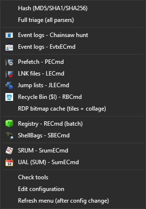
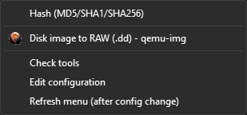

<p align="center">
  
</p>

<h1 align="center">ForensicAid</h1>

<p align="center"><b>Right-click evidence, pick what to do, get the results.</b></p>

ForensicAid puts forensic parsers into your right-click menu. Right-click a file such as `Amcache.hve`, `Security.evtx` or `disk.vhdx`, or a whole folder from KAPE, choose **ForensicAid**, and click the parser you want. It runs the right tool with the right options. The results end up in a `ForensicAid` folder next to the evidence.

| Right-click on a folder | Right-click on a disk image |
|---|---|
|  |  |

The menu only shows what makes sense for the item you clicked. On a `.vhdx` file you get the RAW conversion, and on a folder you get the folder parsers.

## What you need

- Windows 10 or 11. Nothing else needs to be installed: no Python, no admin account.
- The forensic tools you want to use, in one folder, for example `C:\Tools`:
  - [Eric Zimmerman's tools](https://ericzimmerman.github.io): run `Get-ZimmermanTools.ps1` into that folder;
  - [Chainsaw v2](https://github.com/WithSecureLabs/chainsaw);
  - `qemu-img`, only for disk image conversion.

  You don't need all of them. Missing tools just don't show in the menu.

## Install

1. Download or clone this repository.
2. Double-click **`install.cmd`**.
3. Answer the questions:
   - If you have an older version, it asks to remove it. Say **y**. A backup is made first.
   - If some tools are not found, it offers to **look for them on this PC**. Say **y**. It finds tools you already have, for example on your Desktop or in Downloads, and links them in the settings. If it finds several versions of a tool, it asks which one to use.
   - On Windows 11 it may ask for **admin permission** once, so ForensicAid can appear in the main right-click menu. Say **yes**.
4. Done. Right-click any evidence file or folder and look for **ForensicAid**.

Added new tools later? Right-click anything and choose **ForensicAid → Find tools on this PC**.

To remove ForensicAid, double-click **`uninstall.cmd`**.

## What it can do

| Menu item | Use it on | What you get |
|---|---|---|
| Hash | any file or folder | MD5 / SHA1 / SHA256. For a single file the SHA256 is copied to the clipboard. |
| Full triage | a folder, e.g. a KAPE collection | every parser below that fits the folder, in one go |
| Event logs (Chainsaw / EvtxECmd) | `.evtx` or a folder | Sigma detections and parsed event logs |
| NTFS (MFTECmd) | `$MFT`, `$J`, ... | file system timeline |
| Prefetch, LNK, Jump lists, Recycle Bin | `.pf`, `.lnk`, ... or a folder | program execution and file access |
| RDP bitmap cache | `Cache0000.bin`, `bcache*.bmc` | screen fragments from RDP sessions, as images and a collage |
| Amcache, ShimCache, Registry, ShellBags | registry hives or a folder | parsed registry artifacts |
| SRUM, UAL, Windows Timeline | `SRUDB.dat`, `*.mdb`, `ActivitiesCache.db` | resource usage, logons and activity history |
| Repair ESE database | `.edb`, `.mdb`, `.dat` | a repaired **copy** of the database |
| Disk image to RAW | `.vhdx`, `.vhd`, `.vmdk`, ... | a `.dd` image |
| Open in Timeline Explorer | `.csv` | opens the results for review |

**Your evidence is never changed.** Databases are copied before they are parsed or repaired, and each result folder has a `ForensicAid.log` with every command that was run.

## Tray icon

After installing, a red fingerprint appears next to the clock. Right-click it to:
- switch menu items on or off;
- run any action on a file you pick;
- open your last results.

## Windows 11

On Windows 11, ForensicAid appears directly in the right-click menu, not hidden under *Show more options*. For that, it needs a small extra component, which has to be built once with Visual Studio:

```
powershell -ExecutionPolicy Bypass -File win11\build.ps1
```

Run `install.cmd` after building. If you skip this step, ForensicAid still works, but it stays under *Show more options*.

## If something goes wrong

- **The menu item you want is missing:** choose **ForensicAid → Find tools on this PC**. If the tool is still missing, run the full disk scan, `ForensicAid.ps1 -ScanTools -Deep`; it can take a few minutes. **Check tools** shows what is linked right now.
- **ForensicAid shows twice, or the icon looks old:** run `install.cmd` again and let it restart Explorer.
- **The installer seems stuck on "Deployment operation progress":** wait a minute. If it still doesn't move, restart Explorer from Task Manager.

## For advanced users

- Settings file: `%LOCALAPPDATA%\ForensicAid\ForensicAid.config.psd1`. Every option in it is explained by a comment.
- Command line:

  ```powershell
  .\ForensicAid.ps1 -Action triage -Path 'E:\KAPE\C'   # any menu action by id
  .\ForensicAid.ps1 -Action doctor                     # check tools
  .\ForensicAid.ps1 -ScanTools [-Deep] [-Yes]          # find tools and link them in the settings
  ```
- How the tool search works:
  - The quick scan looks where tools usually are: folders from this user's program history (Program Compatibility Assistant, MuiCache), Desktop, Documents, Downloads, `ToolRoots`, and top-level folders named like *Tools*, *Forensic* or *KAPE*. It usually takes seconds.
  - `-Deep` scans whole drives instead.
  - Prefetch and BAM would need admin rights, so they are not used.
- Everything is in two PowerShell scripts: `ForensicAid.ps1` and the tray icon in `ForensicAidTray.ps1`. The Windows 11 component's source is in `win11/`.

## Planned

- Automatic download of the tools ForensicAid supports by default: EZ tools, Chainsaw with Sigma rules, Timeline Explorer, qemu-img. Only the tools the PC scan did not find would be downloaded. If the version on disk is older than the newest release, ForensicAid would ask whether to update.
- KAPE integration.
- Antivirus quarantine: integration of [maldump](https://github.com/NUKIB/maldump), which extracts quarantined files and their metadata from Windows Defender and other antivirus products, on a mounted image or collected folder.
- RDP cache: integration of [RdpCacheStitcher](https://github.com/bsi-bund/rdpcachestitcher), which rebuilds whole screens from the tiles, and decoding the compressed tiles of old `bcache2x.bmc` files.

---

**No guarantees.** Use it on your own responsibility, and work on copies of evidence when in doubt.
