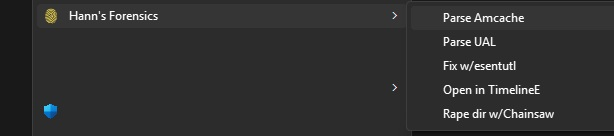

# DFIR Toolbox 

```
 ██████████   ███████████ █████ ███████████                        
░░███░░░░███ ░░███░░░░░░█░░███ ░░███░░░░░███                       
 ░███   ░░███ ░███   █ ░  ░███  ░███    ░███                       
 ░███    ░███ ░███████    ░███  ░██████████                        
 ░███    ░███ ░███░░░█    ░███  ░███░░░░░███                       
 ░███    ███  ░███  ░     ░███  ░███    ░███                       
 ██████████   █████       █████ █████   █████                      
░░░░░░░░░░   ░░░░░       ░░░░░ ░░░░░   ░░░░░                       


 ███████████                   ████  █████                         
░█░░░███░░░█                  ░░███ ░░███                          
░   ░███  ░   ██████   ██████  ░███  ░███████   ██████  █████ █████
    ░███     ███░░███ ███░░███ ░███  ░███░░███ ███░░███░░███ ░░███ 
    ░███    ░███ ░███░███ ░███ ░███  ░███ ░███░███ ░███ ░░░█████░  
    ░███    ░███ ░███░███ ░███ ░███  ░███ ░███░███ ░███  ███░░░███ 
    █████   ░░██████ ░░██████  █████ ████████ ░░██████  █████ █████
   ░░░░░     ░░░░░░   ░░░░░░  ░░░░░ ░░░░░░░░   ░░░░░░  ░░░░░ ░░░░░ 


   Author : Mateusz Nowicki aka Hannon
   Version: 0.1
   Date   : 11.10.2025
```
Annoyed with lack of automation for repetetive tasks related to utilizing Eric Zimmerman's tools decided to prepare this Windows context menu addon via registry integration. Designed for threat hunters, incident responders, and forensic analysts who need fast access to EZ tools directly from Explorer.

Referenced apps can be downloaded here :
- https://ericzimmerman.github.io 
- https://github.com/WithSecureLabs/chainsaw




---

## **Installation**

1. Clone the repository  
2. Configure `config.ini`:
   - `[Settings]` → installation path, icon, logging
   - `[Modules]` → enable/disable specific tools
   - `[Titles]` → display names for context menu
4. Run `setup.py` as administrator:

```bash
python setup.py
```
5. After installation remember to update paths of EZ Tools in each module from config.ini


## **No guarantees that it will work, that it will not break your system.**  
**You're launching this on your own responsibility.**


**List of planned modules :**
- Qemu VHDX->DD
- ArtifactExtractor
- KAPE
- RDPCache Parser  
- EvtxECmd - need to think about relevant EventID list 

- Improving setup to detect if APP paths were updated from default in config.ini and prompt a warning